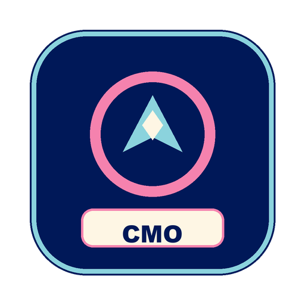

<div align="center">
  
  <h1>Open CMO Studio</h1>
  <p><strong>Your entire marketing operation from one screen.</strong></p>
  <p>Autonomous AI agents that run your growth and remember what works.</p>

  <p>
    <a href="https://github.com/surendranb/open-cmo-studio/releases/tag/v0.3.0"></a>
    <a href="https://opensource.org/licenses/MIT"></a>
    <a href="https://apple.com"></a>
    <a href="https://cerebralvalley.ai/e/meta-ai-developer-hackathon"></a>
    <a href="https://github.com/Arize-ai/phoenix"></a>
    <a href="https://github.com/vectorize-io/hindsight"></a>
  </p>
</div>

---

## What Open CMO Studio Delivers

Open CMO Studio gives founders, marketing leaders, and growth teams a central command center to run their entire marketing operation through autonomous AI agents. 

You set direction and make the calls. The fleet handles the execution across analytics, community monitoring, technical copy, and visual design.

* **Persistent Team Memory**: Built on Vectorize Hindsight, agents retain past campaign outcomes, brand positioning, and audience reactions across every session. Marketing intelligence compounds over time.
* **Trace-Level Observability**: Native OpenTelemetry streaming into Arize Phoenix tracks agent reasoning paths, latency waterfalls, and tool execution down to the millisecond.
* **Continuous Quality Evaluations**: Automated scoring pipelines test copy and data analysis against brand guidelines and factual standards before publication.
* **Live System Adapters**: Direct Model Context Protocol (MCP) integrations query Google Analytics (GA4), Search Console (GSC), developer communities, and headless browser sessions.
* **Human-Gated Governance**: Built on deterministic write lanes where agents execute background work, while the human principal gates durable company truth and approves public releases.

---

## Quickstart

Install the complete harness and daemon suite with one terminal command:

```bash
curl -fsSL https://raw.githubusercontent.com/surendranb/open-cmo-studio/main/install.sh | bash
```

### What It Provisions:
1. **The Core Workspace**: Pre-configured agent workspace at `~/Documents/Open CMO Studio`.
2. **Arize Phoenix Engine**: Local OpenTelemetry trace collector and evaluation dashboard on port `6006`.
3. **Vectorize Hindsight Engine**: Long-term memory server on port `8888`.
4. **The Starter Fleet**: 7 specialized marketing agents and 40+ production marketing skills.

Launch anytime via the global terminal shortcut `open-cmo-studio` or the native desktop application.

---

## System Architecture

```
┌────────────────────────────────────────────────────────────────────────┐
│                        OPEN CMO STUDIO HARNESS                         │
│                                                                        │
│   ┌─────────────────────┐   ┌──────────────────────────────────────┐   │
│   │   Arize Phoenix     │   │         Vectorize Hindsight          │   │
│   │   OTel Tracing      │   │      Long-Term Memory Engine         │   │
│   │   Port: 6006        │   │             Port: 8888               │   │
│   └──────────▲──────────┘   └──────────────────▲───────────────────┘   │
│              │                                 │                       │
│              └────────────────┬────────────────┘                       │
│                               │                                        │
│                 ┌─────────────▼─────────────┐                          │
│                 │     Agent Runtime Core    │                          │
│                 │   (OpenCode Orchestrator) │                          │
│                 └─────────────┬─────────────┘                          │
│                               │                                        │
│   ┌───────────────────────────┴───────────────────────────┐            │
│   │                   THE 7-AGENT FLEET                   │            │
│   │  • cmo            • data-analyst   • social-listener  │            │
│   │  • content-writer • designer       • devops-engineer  │            │
│   │  • distiller (memory consolidation & trace evals)     │            │
│   └───────────────────────────┬───────────────────────────┘            │
│                               │                                        │
│   ┌───────────────────────────┴───────────────────────────┐            │
│   │                  LIVE SYSTEM ADAPTERS                 │            │
│   │  • GA4 / GSC MCP  • Community/Reddit MCP • Playwright │            │
│   └───────────────────────────────────────────────────────┘            │
└────────────────────────────────────────────────────────────────────────┘
```

---

## The 7-Agent Fleet

Open CMO Studio ships with an out-of-the-box roster designed to collaborate under executive direction:

| Agent | Core Function | Operational Scope |
|---|---|---|
| **`cmo`** | Executive Orchestrator | Translates business targets into execution contracts; coordinates subagent briefs; delivers daily BLUF decision memos. |
| **`data-analyst`** | Telemetry & Performance | Reconciles traffic trends across GA4 and Search Console; runs 5-Whys attribution; flags conversion bottlenecks. |
| **`social-listener`** | Market Intelligence | Monitors developer forums and subreddits for emergent pain points; scores commercial intent using ICE criteria. |
| **`content-writer`** | Technical Copywriting | Produces long-form guides, technical tutorials, and product updates aligned strictly with verified product capabilities. |
| **`designer`** | Visual Asset Direction | Generates high-contrast visual cards, architecture diagrams, and carousel layouts with calibrated color systems. |
| **`devops-engineer`** | Distribution & Edge | Builds static release assets, manages edge deployments, and automates release pipelines. |
| **`distiller`** | Quality & Memory Guard | Audits daily Phoenix traces for tool failures; consolidates operational heuristics into Hindsight memory banks. |

### Building Custom Agents
Add new agents by declaring their role in `.opencode/agent/<name>.md` and registering their runtime mode in `opencode.json`. Agents automatically inherit the harness's memory, tracing, and skill catalog.

---

## Enterprise Agent Infrastructure

### 1. Persistent Experiential Memory (Hindsight)
Conventional agents reset between turns. Open CMO Studio integrates Vectorize Hindsight so agents recall past campaign outcomes, channel nuances, and user preferences automatically:
- **Auto-Retain**: Captures operational milestones and corrections when an agent session concludes.
- **Dynamic Bank Partitioning**: Keeps memory banks strictly scoped per product, team, or workspace.
- **Context Injection**: Surfacing relevant past learnings before drafting new campaigns or analyzing anomalies.

### 2. Full Observability & Tracing (Phoenix)
Every prompt template, tool interaction, and subagent delegation streams to Arize Phoenix via standard OpenTelemetry spans:
- **Trace Waterfalls**: Diagnose exact latency bottlenecks across deep multi-agent delegation trees.
- **Tool Reliability Audits**: Identify failure rates and schema mismatches across local MCP adapters.
- **Token Economics**: Monitor token consumption across agents and models.

### 3. Automated Evaluations & Quality Gates
The `distiller` agent runs scheduled evaluations against execution traces via `scripts/evaluate-traces.mjs`:
- **Reliability Audits**: Flags unhandled exceptions and tool call timeouts.
- **Anti-Slop Compliance**: Strips corporate buzzwords, passive prose, and empty claims before publication.
- **Epistemic Labeling**: Verifies that claims cite ground truth facts (`[Fact: ...]`, `[Inference: ...]`).

---

## 40+ Packaged Marketing Skills

Open CMO Studio comes bundled with an engineering-grade skill library covering every growth discipline:
- **Growth & Measurement**: `ab-test-analysis`, `funnel-analysis`, `cohort-analysis`, `metric-reconciliation`, `traffic-diagnosis`.
- **Strategy & Execution**: `competitive-teardown`, `problem-solving`, `premortem`, `launch-runbook`, `standup`.
- **Communication & Positioning**: `business-writing`, `technical-aeo-seo`, `journalism-ap`, `plain-language`, `scott-adams`.
- **Visuals & Design**: `high-end-visual-design`, `brandkit`, `minimalist-ui`, `illustrator`.
- **Diagnostics**: `5whys`, `bot-visibility`, `mcp-diagnosis`, `pagespeed`.

---

## License

MIT License. Designed for builders, marketing leaders, and founders scaling autonomous growth.
